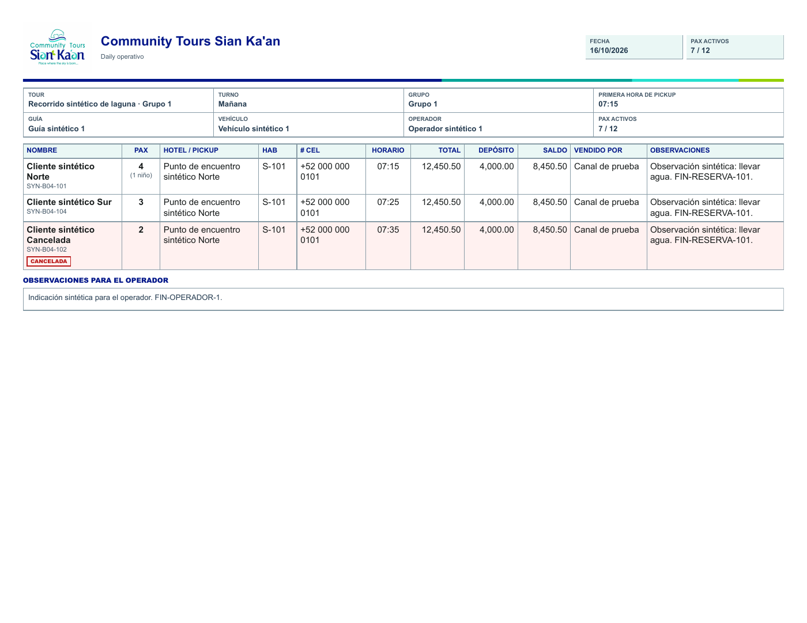
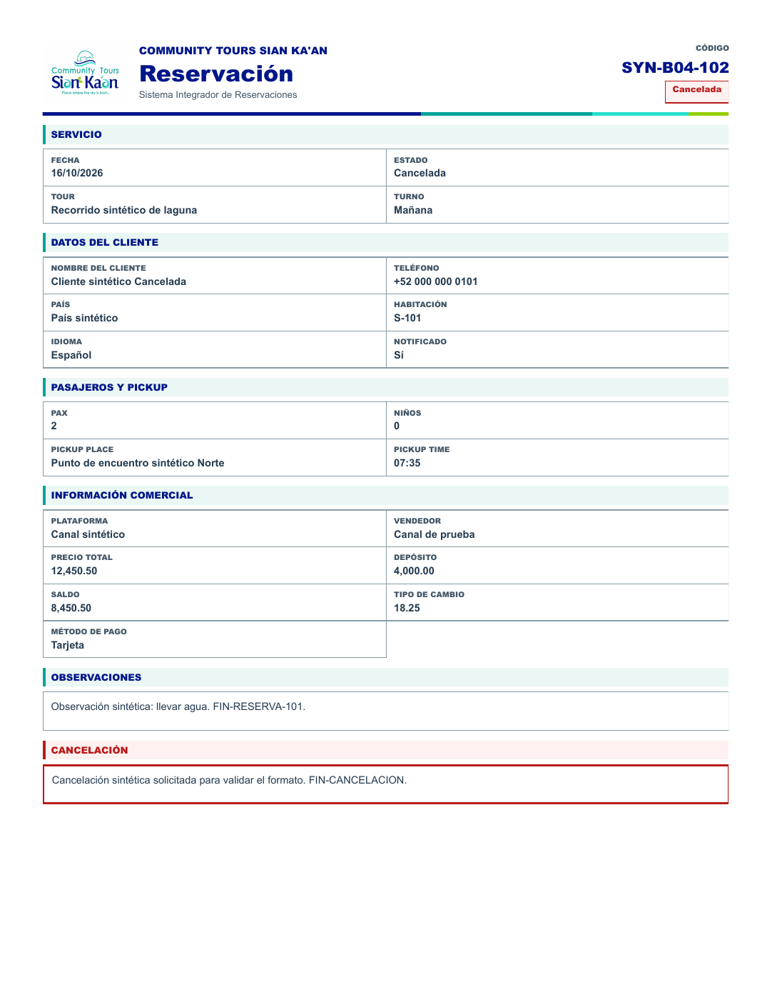

# BRANDING-04 — Daily PDF e impresión individual

> Cierre posterior: el usuario aprobó visualmente Electron y los dos documentos
> en la solicitud BRANDING-05 + GITHUB. Este informe conserva la evidencia de
> su fase; el estado final se documenta en [BRANDING-05](BRANDING-05.md).

Fecha: 16 de octubre de 2026. **Implementado y validado localmente; pendiente de
aprobación visual de ambos documentos. No se realizó commit ni push.**

## Identidad común y recursos

Se revisaron AGENTS.md, BRANDING-01/02/03, los dos renderizadores y sus reglas
compartidas antes de cambiar impresión. Los dos documentos utilizan el mismo
encabezado con logo completo, texto azul, fondo blanco, encabezados aqua suave
y una línea con azul, turquesa, aqua y lima. El rojo identifica cancelaciones y
se conserva el texto explícito para que el estado sea reconocible sin color.

Los roles `--print-*` están centralizados en frontend/css/variables.css y derivan
de #011689, #00A499, #24E0CF, #94D000 y #FFFFFF. Se usan neutros oscuros para
textos/bordes y fondos claros para no saturar la impresión. Las cinco muestras
exactas se detectaron en los renders de ambos tipos de documento.

El recurso existente tenía extensión `.jpg`. Se creó la ruta solicitada
frontend/assets/branding/community-tours-sian-kaan-logo.jpeg como copia binaria
exacta, sin recorte, redibujo, compresión ni cambio de proporciones; `.jpg` sigue
sirviendo a la interfaz de BRANDING-03. Los dos archivos tienen SHA-256:

`7219c6cc58c592c9eed0499fc1804e55f1631ae4e48f03806f6e2801907b2d43`

El original conserva 1296 × 932 píxeles. CSS usa ancho de 90 px y altura automática
con object-fit:contain; se verificó carga/decodificación y proporción dentro del
redondeo inferior a un píxel del motor de impresión.

## Documento 1 — Daily PDF

Se conservan **carta horizontal, 792 × 612 pt, márgenes de 8 mm y once columnas**:
Nombre, PAX, Hotel/Pickup, Hab, # Cel, Horario, Total, Depósito, Saldo, Vendido por
y Observaciones. También se conservan el orden por pickup, niños, códigos,
marcación de canceladas, metadatos de tour/turno/grupo/guía/vehículo/operador,
conteos activos, importes y observaciones del operador.

El logo se incorporó al encabezado sin sustituir textos ni datos. Cada transporte
sigue empezando en una hoja nueva, la última no añade un salto final y thead se
repite al continuar la tabla. Las notas extensas pueden continuar en páginas
posteriores. Se mantienen exclusiones y avisos existentes de reservas sin asignar
y grupos sin transporte; no se incorporaron nuevos datos operativos.

La regla de página se nombró `daily-operativo` y se asigna únicamente a
.daily-print-sheet. La reservación individual conserva su regla independiente.
Las reglas de tipografía/columnas del Daily no se aplican a la ficha individual.

**Corrección técnica de legibilidad:** BRANDING-01 detectó que los td globales
imponían 14 px/20 px frente al tamaño nominal menor de la tabla. Se especificó
herencia explícita de 11.5 px/14 px para td (8.625 pt en el PDF) y encabezados de
9 px/11 px. Esto mantiene las once columnas con sus porcentajes originales, evita
que la cascada global domine la tabla y separa visualmente nombre/código. No se
ocultan datos ni se aplica un escalado automático de toda la hoja. Los importes
permiten ajuste de línea si un valor excepcional no cabe, conservando su texto.

**Mecanismos:** Exportar PDF sigue usando el preload/IPC existente y
printToPDF({printBackground:true,preferCSSPageSize:true}); Imprimir sigue usando
window.print después de renovar permisos. Antes de capturar se espera la carga
y decodificación de todos los logos locales. El IPC también verifica los recursos
para cubrir invocaciones directas; conserva comprobación de emisor, vista, fecha,
backend autorizado, token y versión, antes y después del diálogo de guardado.
No se añadió una biblioteca PDF ni se cambió el nombre de archivo del producto.

## Documento 2 — Imprimir reservación individual

Se conservan **carta vertical, 612 × 792 pt y márgenes de 12 mm**. La cabecera
mantiene empresa, título, código y estado, ahora acompañados del mismo logo.
La disposición de dos columnas conserva sus secciones y campos:

- Servicio: fecha, estado, tour y turno.
- Cliente: nombre, teléfono, país, habitación, idioma y notificación.
- Pasajeros y pickup: PAX, niños, lugar y hora.
- Información comercial: plataforma, vendedor, precio, depósito, saldo, tipo de
  cambio y método de pago.
- Observaciones y cancelación con motivo cuando corresponde.

Los textos funcionales, datos, formatters y cálculos no se cambiaron. Las
canceladas mantienen su estado, motivo y bloque específico con rojo semántico.
El flujo de bloques externos se ajustó para permitir continuaciones de notas
extensas, manteniendo las cuadrículas internas de dos columnas. Los títulos se
mantienen junto al contenido y no se recortan observaciones para forzar una página.

La regla existente `reservacion-individual` conserva tamaño y márgenes. Todos sus
selectores específicos permanecen bajo body.is-printing-reservacion. El documento
Daily se oculta durante la impresión individual y no hay reglas de orientación
globales que cambien el otro formato.

**Mecanismo:** la acción obtiene el detalle autorizado, conserva la fusión con el
catálogo y prepara el mismo contenedor. Luego espera el logo, renueva sesión y
comprueba que el documento y versión siguen vigentes antes de window.print.
Se mantienen la limpieza afterprint, el temporizador y la eliminación de datos
al cerrar sesión. La espera no permite imprimir datos de una sesión anterior.

## Pruebas visuales obligatorias y archivos

Las muestras contienen exclusivamente datos sintéticos. Se renderizaron e
inspeccionaron **las once páginas** de los seis PDF con Poppler; se comprobó texto
extraído y geometría con pdfplumber. Todas las páginas tienen contenido; no se
detectaron caracteres fuera del área de página ni datos cortados en la revisión
visual. Los textos finales de las observaciones y todos los marcadores numerados
están presentes. Las continuaciones son contenido real de los fixtures largos.

| Caso | Páginas | PDF |
| --- | ---: | --- |
| Daily de un transporte | 1 | [Abrir](branding-04/daily-un-transporte.pdf) |
| Daily de varios transportes | 2 | [Abrir](branding-04/daily-varios-transportes.pdf) |
| Daily con observaciones extensas | 4 | [Abrir](branding-04/daily-observaciones-extensas.pdf) |
| Reservación programada | 1 | [Abrir](branding-04/reservacion-programada.pdf) |
| Reservación cancelada | 1 | [Abrir](branding-04/reservacion-cancelada.pdf) |
| Reservación con textos extensos | 2 | [Abrir](branding-04/reservacion-textos-extensos.pdf) |

También hay PNG de todas las páginas junto a cada PDF. Vistas principales:

Se revisaron representaciones en escala de grises para Daily y ficha cancelada;
conservan textos, líneas y etiquetas legibles. Están en
[Daily en grises](branding-04/daily-escala-grises-1.png) y
[Reservación en grises](branding-04/reservacion-escala-grises-1.png).
La validación es digital; no se envió ningún trabajo a una impresora física.

En la prueba larga del Daily, una fila extensa pasa a la siguiente página para
conservarse completa, conforme a break-inside:avoid. Puede quedar espacio libre
en la página anterior; no es una página en blanco. En continuaciones se repite
la cabecera de la tabla, como antes; no se añadió una nueva plantilla ni una
numeración funcional de páginas.

## Pruebas automatizadas y permisos

**691 pruebas aprobadas en 34 suites; cero fallos.** Se ejecutaron todas las
suites backend excepto api.test.js, más el test de persistencia simulada de GYG,
con --runInBand, --no-cache, entorno sin credenciales heredadas,
APP_CONFIG_PATH=NUL y noPostgres.js bloqueando query/connect reales.
api.test.js se excluyó porque requiere persistencia y puede modificar datos.

Se añadió printBranding.test.js y su harness Electron con API GET simulada:

1. Seis casos con renderizadores reales y comparación exacta de textContent
   anterior/posterior usando los mismos fixtures (evidencia local de esta fase).
2. Once columnas por tabla, logo completo decodificado y limpieza tras afterprint.
3. Administrador genera Daily por el manejador IPC original y printToPDF real.
4. Consulta all conserva impresión Daily; selected conserva impresión individual
   autorizada y sigue rechazado para Daily por ruta e IPC.
5. Revocar permisos durante el diálogo impide escribir el PDF.
6. Un logo roto impide exportar un documento incompleto.
7. Revocar permisos mientras se espera el logo impide imprimir la ficha anterior.
8. Un detalle no autorizado/inexistente no genera documento de impresión.

El harness evalúa el bloque original del IPC de electron/main.js, con ventana,
preload y motor de impresión reales. Solo simula API, elección de destino y
window.print para evitar impresora física. No arranca main/backend productivos,
PostgreSQL ni proveedores. Las otras suites cubren regresión de ACCESS-SCOPE,
sesiones, capacidad, operaciones e integraciones aisladas. No se tocaron sus
implementaciones ni sus credenciales.

El resumen de los ocho controles y los seis archivos está en
[validacion.json](branding-04/validacion.json). Logs, comparación anterior,
extracción de texto y auditorías detalladas permanecen en el laboratorio ignorado
.access-scope-lab/branding-04. No se incorporan secretos, respaldos ni datos reales.

## Archivos cambiados en esta fase

- frontend/css/variables.css: roles corporativos de impresión.
- frontend/css/pages.css: páginas independientes, marca y estilos específicos.
- frontend/js/ui.js: espera acotada de carga y decodificación de imágenes.
- frontend/pages/daily.js: logo y preparación de recursos antes de imprimir/exportar.
- frontend/pages/reservaciones.js: logo y preparación segura antes de imprimir.
- electron/main.js: espera de recursos dentro del flujo autorizado existente.
- frontend/assets/branding/: alias .jpeg idéntico al original y README actualizado.
- backend/__tests__/printBranding.test.js y helpers/printBrandingHarness.cjs.
- docs/BRANDING-04.md y docs/branding-04/: informe, PDF y renders sintéticos.

Se conservaron los cambios pendientes de BRANDING-03. La comparación de hashes
contra el inicio de esta fase confirma que los demás archivos existentes no se
modificaron. No hubo cambios de endpoints, modelo, PostgreSQL, reservaciones,
reglas de negocio, autorizaciones ACCESS-SCOPE, integraciones o lanzadores.
No se instalaron dependencias ni se ejecutaron migraciones o sincronizaciones.

**Pendiente:** aprobación visual de ambos diseños por el usuario. Los documentos
siguen sin commit ni push. La fase no certifica PDF/UA ni comportamiento de un
modelo de impresora/driver específico.
